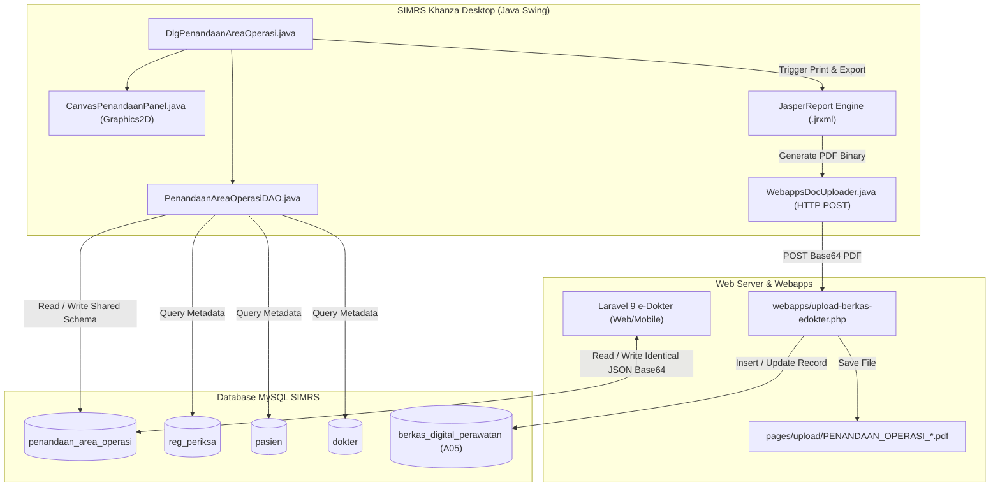

# Technical Specification & Handoff Document: Modul Penandaan Area Operasi (SIMRS Khanza Java)

- **Dokumen Versi**: 1.0.0
- **Target Platform**: SIMRS Khanza Desktop (Java Swing / NetBeans Form GUI / JDK 8 & 11 / MySQL)
- **Kompatibilitas**: Laravel e-Dokter (Web / Mobile) & SIMRS Webapps Server
- **Tanggal Rilis Dokumen**: 20 Agustus 2026
- **Kode Berkas Digital**: `A05` (*Penandaan Area Operasi*)

---

## 1. Executive Summary & Tujuan

Modul **Penandaan Area Operasi** (*Surgical Site Marking*) adalah modul klinis keselamatan pasien pra-bedah yang berfungsi untuk mendokumentasikan penandaan lokasi insisi/tindakan operasi pada diagram anatomi tubuh pasien secara digital.

Spesifikasi ini disusun sebagai panduan teknis (*handoff document*) bagi pengembang aplikasi desktop **Java SIMRS Khanza** agar dapat mengimplementasikan modul ini dengan standar antarmuka Swing, mendukung interaktivitas kanvas (pin bernomor & coretan spidol bebas), terintegrasi penuh dua arah (*two-way interoperability*) dengan database `penandaan_area_operasi` yang digunakan di Laravel e-Dokter, serta otomatis menghasilkan cetakan PDF JasperReports dan mengarsipkannya ke `berkas_digital_perawatan` (kode `A05`).

---

## 2. Arsitektur Sistem & Data Flow



---

## 3. Database Schema & Data Contract

### 3.1 Tabel Utama: `penandaan_area_operasi`

Modul Java menggunakan tabel MySQL yang **sama persis** dengan Laravel e-Dokter tanpa mengubah skema tabel.

```sql
CREATE TABLE IF NOT EXISTS `penandaan_area_operasi` (
  `id` BIGINT UNSIGNED AUTO_INCREMENT PRIMARY KEY,
  `no_rawat` VARCHAR(17) NOT NULL,
  `no_rm` VARCHAR(15) NOT NULL,
  `nama_pasien` VARCHAR(100) NOT NULL,
  `tgl_lahir` DATE DEFAULT NULL,
  `prosedur_operasi` TEXT NOT NULL,
  `operator_id` VARCHAR(20) DEFAULT NULL,
  `nama_operator` VARCHAR(100) NOT NULL,
  `tanggal_penandaan` DATETIME NOT NULL,
  `gambar_penandaan_base64` LONGTEXT NOT NULL,
  `format_gambar` VARCHAR(20) DEFAULT 'image/png',
  `created_at` TIMESTAMP NULL DEFAULT CURRENT_TIMESTAMP,
  `updated_at` TIMESTAMP NULL DEFAULT CURRENT_TIMESTAMP ON UPDATE CURRENT_TIMESTAMP,
  UNIQUE KEY `penandaan_area_operasi_no_rawat_unique` (`no_rawat`),
  INDEX `penandaan_area_operasi_no_rm_index` (`no_rm`),
  INDEX `penandaan_area_operasi_operator_id_index` (`operator_id`)
) ENGINE=InnoDB DEFAULT CHARSET=latin1;
```

### 3.2 Spesifikasi Kontrak Payload `gambar_penandaan_base64`

Kolom `gambar_penandaan_base64` berisi string JSON UTF-8 valid berupa pasangan *Key-Value*:
- **Key**: ID sudut pandang anatomi (konvensi nama tetap).
- **Value**: Data URI Base64 citra PNG utuh (`data:image/png;base64,iVBORw0KGgo...`). Citra ini merupakan hasil komposit dari template anatomi dasar yang telah digambari pin dan coretan.

#### Daftar 14 Kunci Tampilan Anatomi (*View Keys*):
1. `body_front`: Tubuh tampak depan
2. `body_back`: Tubuh tampak belakang
3. `head_front`: Kepala tampak depan
4. `head_back`: Kepala tampak belakang
5. `head_left_profile`: Kepala profil samping kiri
6. `head_right_profile`: Kepala profil samping kanan
7. `hand_left_palm`: Telapak tangan kiri (*palmar*)
8. `hand_right_palm`: Telapak tangan kanan (*palmar*)
9. `hand_left_dorsal`: Punggung tangan kiri (*dorsal*)
10. `hand_right_dorsal`: Punggung tangan kanan (*dorsal*)
11. `foot_left_plantar`: Telapak kaki kiri (*plantar*)
12. `foot_right_plantar`: Telapak kaki kanan (*plantar*)
13. `foot_left_dorsal`: Punggung kaki kiri (*dorsal*)
14. `foot_right_dorsal`: Punggung kaki kanan (*dorsal*)

Contoh format JSON dalam database:
```json
{
  "body_front": "data:image/png;base64,iVBORw0KGgoAAAANSUhEUgAA...",
  "body_back": "data:image/png;base64,iVBORw0KGgoAAAANSUhEUgAA...",
  "head_front": "data:image/png;base64,iVBORw0KGgoAAAANSUhEUgAA...",
  "hand_left_palm": "data:image/png;base64,iVBORw0KGgoAAAANSUhEUgAA...",
  "foot_left_plantar": "data:image/png;base64,iVBORw0KGgoAAAANSUhEUgAA..."
}
```

---

## 4. UI/UX Design & Tata Letak Java Swing

Formulir diimplementasikan sebagai `JDialog` modal bawaan Khanza: `DlgPenandaanAreaOperasi.java`.

### 4.1 Wireframe Tata Letak Layar (Swing Form)

```text
+-------------------------------------------------------------------------------------------------------+
|  [X] PENANDAAN AREA OPERASI (SURGICAL SITE MARKING)                                                  |
+-------------------------------------------------------------------------------------------------------+
| No. Rawat : [ 2026/08/20/000001 ] [Cari]  Tgl Lahir : [ 1985-05-12 (41 Th) ]  JK : [ PEREMPUAN ]     |
| No. R.M.  : [ 012345           ]          Pasien    : [ SITI AMINAH                  ]               |
| Operator  : [ D001 ] [ dr. Budi Santoso, Sp.B                    ] [ ... ]  Tgl Simpan: 20/08/2026    |
| Prosedur  : [ Appendectomy Laparoskopi cito                                              ]            |
+-------------------------------------------------------------------------------------------------------+
| TAB VIEW DIAGRAM ANATOMI:                                                                             |
| [ 1. Tubuh Utuh ]  [ 2. Area Kepala ]  [ 3. Area Tangan ]  [ 4. Area Kaki ]                           |
+-------------------------------------------------------------------------------------------------------+
| TOOLBAR KANVAS:                                                                                       |
| Mode: (o) Pin Merah Bernomor   ( ) Coretan Spidol (Freehand)   [Warna: Merah v]  [Ukuran Garis: [ 3 ]] |
| Aksi: [ Undo Pin/Garis ]  [ Reset / Clear Diagram ]                                                   |
+-------------------------------------------------------------------------------------------------------+
| AREA KANVAS (Grid / Split Panel):                                                                     |
|                                                                                                       |
|    +------------------------------+     +------------------------------+                              |
|    |      TUBUH TAMPAK DEPAN      |     |     TUBUH TAMPAK BELAKANG    |                              |
|    |                              |     |                              |                              |
|    |         ( ( 1 ) )            |     |                              |                              |
|    |           /|\                |     |              /|\             |                              |
|    |          / | \               |     |             / | \            |                              |
|    |         /  |  \              |     |            /  |  \           |                              |
|    |            |                 |     |               |              |                              |
|    |           / \                |     |              / \             |                              |
|    |          /   \               |     |             /   \            |                              |
|    +------------------------------+     +------------------------------+                              |
+-------------------------------------------------------------------------------------------------------+
| STATUS: [ Data berhasil dimuat. Siap diedit. ]                                                        |
| TOMBOL: [ Simpan & Arsipkan A05 ]  [ Cetak Jasper ]  [ Hapus ]  [ Bersihkan ]  [ Keluar ]             |
+-------------------------------------------------------------------------------------------------------+
```

### 4.2 Template Gambar Diagram Berdasarkan Jenis Kelamin
Aset diagram disimpan pada classpath aplikasi Java:
- Paket: `resource/diagrams/penandaan/`
- Folder Sub:
  - `female/`: `body_front.png`, `body_back.png`, `head_*.png`, `hand_*.png`, `foot_*.png`
  - `male/`: `body_front.png`, `body_back.png`, `head_*.png`, `hand_*.png`, `foot_*.png`

Saat pasien dipilih:
1. Periksa nilai jenis kelamin dari tabel `pasien.jk` (`'L'` atau `'P'`).
2. Muat template dasar sesuai folder `male/` atau `female/`.
3. Jika data di database `penandaan_area_operasi` sudah memiliki record gambar Base64 untuk `no_rawat` tersebut, dekode dan timpa kanvas dengan data tersimpan.

---

## 5. Spesifikasi Komponen & Class Java Blueprint

### 5.1 Struktur Paket (Package Hierarchy)
```text
rekammedis/
├── DlgPenandaanAreaOperasi.java         // Main UI JDialog Form (NetBeans GUI Builder)
├── CanvasPenandaanPanel.java            // Custom JPanel untuk rendering gambar, Pin, & Coretan
├── PenandaanAreaOperasiDAO.java         // Data Access Object (JDBC Prepared Statements)
├── ModelPenandaanAreaOperasi.java       // Entity POJO model
└── util/
    ├── ImageBase64Converter.java        // Helper Encode/Decode BufferedImage <-> Base64 URI
    └── WebappsDocUploader.java          // HTTP Client untuk posting PDF ke webapps upload
```

---

### 5.2 Komponen Interaktif Kanvas: `CanvasPenandaanPanel.java`

Komponen kanvas mewarisi `JPanel` dan menangani event mouse:

```java
package rekammedis;

import java.awt.*;
import java.awt.event.*;
import java.awt.image.BufferedImage;
import java.util.ArrayList;
import java.util.List;
import javax.swing.JPanel;

public class CanvasPenandaanPanel extends JPanel {

    public enum ToolMode { PIN_NUMBERED, FREEHAND_DRAW }

    private BufferedImage baseTemplateImage;
    private ToolMode currentMode = ToolMode.PIN_NUMBERED;
    private Color drawColor = Color.RED;
    private int strokeWidth = 3;

    // Data structures for Undo support
    private final List<PinMarker> pinList = new ArrayList<>();
    private final List<DrawingPath> pathList = new ArrayList<>();
    private DrawingPath currentPath = null;

    public static class PinMarker {
        public int x, y;
        public int number;
        public Color color;

        public PinMarker(int x, int y, int number, Color color) {
            this.x = x;
            this.y = y;
            this.number = number;
            this.color = color;
        }
    }

    public static class DrawingPath {
        public List<Point> points = new ArrayList<>();
        public Color color;
        public int strokeWidth;

        public DrawingPath(Color color, int strokeWidth) {
            this.color = color;
            this.strokeWidth = strokeWidth;
        }
    }

    public CanvasPenandaanPanel() {
        setPreferredSize(new Dimension(300, 380));
        setBackground(Color.WHITE);

        MouseAdapter adapter = new MouseAdapter() {
            @Override
            public void mousePressed(MouseEvent e) {
                if (currentMode == ToolMode.PIN_NUMBERED) {
                    int nextNum = pinList.size() + 1;
                    pinList.add(new PinMarker(e.getX(), e.getY(), nextNum, drawColor));
                    repaint();
                } else if (currentMode == ToolMode.FREEHAND_DRAW) {
                    currentPath = new DrawingPath(drawColor, strokeWidth);
                    currentPath.points.add(e.getPoint());
                    pathList.add(currentPath);
                    repaint();
                }
            }

            @Override
            public void mouseDragged(MouseEvent e) {
                if (currentMode == ToolMode.FREEHAND_DRAW && currentPath != null) {
                    currentPath.points.add(e.getPoint());
                    repaint();
                }
            }

            @Override
            public void mouseReleased(MouseEvent e) {
                currentPath = null;
            }
        };

        addMouseListener(adapter);
        addMouseMotionListener(adapter);
    }

    public void setTemplateImage(BufferedImage img) {
        this.baseTemplateImage = img;
        this.pinList.clear();
        this.pathList.clear();
        repaint();
    }

    public void undoLastAction() {
        if (currentMode == ToolMode.PIN_NUMBERED && !pinList.isEmpty()) {
            pinList.remove(pinList.size() - 1);
            repaint();
        } else if (currentMode == ToolMode.FREEHAND_DRAW && !pathList.isEmpty()) {
            pathList.remove(pathList.size() - 1);
            repaint();
        }
    }

    public void clearAll() {
        pinList.clear();
        pathList.clear();
        repaint();
    }

    @Override
    protected void paintComponent(Graphics g) {
        super.paintComponent(g);
        Graphics2D g2 = (Graphics2D) g.create();
        g2.setRenderingHint(RenderingHints.KEY_ANTIALIASING, RenderingHints.VALUE_ANTIALIAS_ON);
        g2.setRenderingHint(RenderingHints.KEY_TEXT_ANTIALIASING, RenderingHints.VALUE_TEXT_ANTIALIAS_ON);

        // 1. Draw Base Template Image
        if (baseTemplateImage != null) {
            g2.drawImage(baseTemplateImage, 0, 0, getWidth(), getHeight(), null);
        }

        // 2. Draw Freehand Paths
        for (DrawingPath path : pathList) {
            if (path.points.size() < 2) continue;
            g2.setColor(path.color);
            g2.setStroke(new BasicStroke(path.strokeWidth, BasicStroke.CAP_ROUND, BasicStroke.JOIN_ROUND));
            for (int i = 0; i < path.points.size() - 1; i++) {
                Point p1 = path.points.get(i);
                Point p2 = path.points.get(i + 1);
                g2.drawLine(p1.x, p1.y, p2.x, p2.y);
            }
        }

        // 3. Draw Numbered Pins
        int pinRadius = 11;
        for (PinMarker pin : pinList) {
            // Pin outer circle
            g2.setColor(pin.color);
            g2.fillOval(pin.x - pinRadius, pin.y - pinRadius, pinRadius * 2, pinRadius * 2);
            
            // Pin white border
            g2.setColor(Color.WHITE);
            g2.setStroke(new BasicStroke(1.5f));
            g2.drawOval(pin.x - pinRadius, pin.y - pinRadius, pinRadius * 2, pinRadius * 2);

            // Number text inside pin
            g2.setFont(new Font("SansSerif", Font.BOLD, 11));
            FontMetrics fm = g2.getFontMetrics();
            String label = String.valueOf(pin.number);
            int tx = pin.x - (fm.stringWidth(label) / 2);
            int ty = pin.y + (fm.getAscent() / 2) - 2;
            g2.drawString(label, tx, ty);
        }

        g2.dispose();
    }

    /**
     * Export canvas content as a flat BufferedImage for Base64 serialization
     */
    public BufferedImage exportToImage() {
        BufferedImage output = new BufferedImage(getWidth(), getHeight(), BufferedImage.TYPE_INT_ARGB);
        Graphics2D g2 = output.createGraphics();
        paintComponent(g2);
        g2.dispose();
        return output;
    }
}
```

---

### 5.3 Helper Konversi Base64: `ImageBase64Converter.java`

```java
package rekammedis.util;

import java.awt.image.BufferedImage;
import java.io.ByteArrayInputStream;
import java.io.ByteArrayOutputStream;
import java.io.IOException;
import java.util.Base64;
import javax.imageio.ImageIO;

public class ImageBase64Converter {

    private static final String DATA_URL_PREFIX = "data:image/png;base64,";

    public static String encodeToBase64(BufferedImage image) throws IOException {
        ByteArrayOutputStream baos = new ByteArrayOutputStream();
        ImageIO.write(image, "png", baos);
        byte[] bytes = baos.toByteArray();
        return DATA_URL_PREFIX + Base64.getEncoder().encodeToString(bytes);
    }

    public static BufferedImage decodeFromBase64(String dataUri) throws IOException {
        if (dataUri == null || dataUri.trim().isEmpty()) {
            return null;
        }
        String base64Data = dataUri;
        if (base64Data.contains(",")) {
            base64Data = base64Data.substring(base64Data.indexOf(",") + 1);
        }
        byte[] bytes = Base64.getDecoder().decode(base64Data);
        ByteArrayInputStream bais = new ByteArrayInputStream(bytes);
        return ImageIO.read(bais);
    }
}
```

---

### 5.4 DAO Layer: `PenandaanAreaOperasiDAO.java`

```java
package rekammedis;

import fungsi.koneksiDB;
import java.sql.*;
import java.util.HashMap;
import java.util.Map;
import org.json.JSONObject;

public class PenandaanAreaOperasiDAO {

    private final Connection conn = koneksiDB.condb();

    public boolean simpanOrUpdate(ModelPenandaanAreaOperasi model) throws SQLException {
        String sql = "INSERT INTO penandaan_area_operasi ("
                   + "no_rawat, no_rm, nama_pasien, tgl_lahir, prosedur_operasi, "
                   + "operator_id, nama_operator, tanggal_penandaan, gambar_penandaan_base64, format_gambar"
                   + ") VALUES (?, ?, ?, ?, ?, ?, ?, ?, ?, 'image/png') "
                   + "ON DUPLICATE KEY UPDATE "
                   + "prosedur_operasi = VALUES(prosedur_operasi), "
                   + "operator_id = VALUES(operator_id), "
                   + "nama_operator = VALUES(nama_operator), "
                   + "tanggal_penandaan = VALUES(tanggal_penandaan), "
                   + "gambar_penandaan_base64 = VALUES(gambar_penandaan_base64), "
                   + "updated_at = NOW()";

        try (PreparedStatement ps = conn.prepareStatement(sql)) {
            ps.setString(1, model.getNoRawat());
            ps.setString(2, model.getNoRm());
            ps.setString(3, model.getNamaPasien());
            if (model.getTglLahir() != null) {
                ps.setDate(4, new java.sql.Date(model.getTglLahir().getTime()));
            } else {
                ps.setNull(4, Types.DATE);
            }
            ps.setString(5, model.getProsedurOperasi());
            ps.setString(6, model.getOperatorId());
            ps.setString(7, model.getNamaOperator());
            ps.setTimestamp(8, new Timestamp(System.currentTimeMillis()));
            ps.setString(9, model.getGambarJsonString());

            return ps.executeUpdate() > 0;
        }
    }

    public ModelPenandaanAreaOperasi getByNoRawat(String noRawat) throws SQLException {
        String sql = "SELECT * FROM penandaan_area_operasi WHERE no_rawat = ?";
        try (PreparedStatement ps = conn.prepareStatement(sql)) {
            ps.setString(1, noRawat);
            try (ResultSet rs = ps.executeQuery()) {
                if (rs.next()) {
                    ModelPenandaanAreaOperasi m = new ModelPenandaanAreaOperasi();
                    m.setId(rs.getLong("id"));
                    m.setNoRawat(rs.getString("no_rawat"));
                    m.setNoRm(rs.getString("no_rm"));
                    m.setNamaPasien(rs.getString("nama_pasien"));
                    m.setTglLahir(rs.getDate("tgl_lahir"));
                    m.setProsedurOperasi(rs.getString("prosedur_operasi"));
                    m.setOperatorId(rs.getString("operator_id"));
                    m.setNamaOperator(rs.getString("nama_operator"));
                    m.setTanggalPenandaan(rs.getTimestamp("tanggal_penandaan"));
                    m.setGambarJsonString(rs.getString("gambar_penandaan_base64"));
                    return m;
                }
            }
        }
        return null;
    }
}
```

---

## 6. Integrasi Entry Points pada SIMRS Khanza

Untuk memberikan alur kerja yang mulus bagi dokter bedah dan perawat, dialog penandaan area operasi harus dipasang pada titik-titik menu berikut:

| No | Kelas Form Khanza | Lokasi UI Trigger | Parameter yang Dikirim ke Dialog |
|:---|:---|:---|:---|
| 1 | `simrskhanza.DlgReg` (Rawat Jalan) | Tab / Popup Menu: `Rekam Medis` -> `Penandaan Area Operasi` | `no_rawat`, `no_rkm_medis`, `nm_pasien`, `jk`, `tgl_lahir`, `kd_dokter` |
| 2 | `simrskhanza.DlgKamarInap` / `DlgRawatInap` (Rawat Inap) | Popup Menu: `Rekam Medis` -> `Penandaan Area Operasi` | `no_rawat`, `no_rkm_medis`, `nm_pasien`, `jk`, `tgl_lahir`, `kd_dokter` |
| 3 | `simrskhanza.DlgOperasi` / `DlgBookingOperasi` (Jadwal/Kamar Bedah) | Tombol Aksi / Popup: `Formulir Pra-Bedah` -> `Penandaan Area Operasi` | `no_rawat`, `no_rkm_medis`, `nm_pasien`, `jk`, `tgl_lahir`, `operator` |

Contoh pemanggilan dialog dari Form Pemanggil:
```java
DlgPenandaanAreaOperasi dlg = new DlgPenandaanAreaOperasi(null, true);
dlg.setPasien(
    tbPasien.getValueAt(row, colNoRawat).toString(),
    tbPasien.getValueAt(row, colNoRm).toString(),
    tbPasien.getValueAt(row, colNmPasien).toString(),
    tbPasien.getValueAt(row, colJk).toString(),
    tbPasien.getValueAt(row, colTglLahir).toString(),
    akses.getkode() // ID dokter/operator aktif dari session Khanza
);
dlg.setSize(1100, 720);
dlg.setLocationRelativeTo(this);
dlg.setVisible(true);
```

---

## 7. Cetakan JasperReports & Auto-Upload Berkas Digital (A05)

### 7.1 Template JasperReports: `rptPenandaanAreaOperasi.jrxml`

Laporan dicetak pada ukuran kertas **A4 Portrait** (210 x 297 mm) dengan susunan:
1. **Header / KOP Rumah Sakit**: Nama instansi, alamat, logo RS, judul dokumen: `FORMULIR PENANDAAN AREA OPERASI`.
2. **Metadata Pasien (Tabel 2 Kolom)**: No. RM, Nama Pasien, Tgl Lahir / Umur, Jenis Kelamin, Tanggal & Jam Penandaan, Dokter Operator.
3. **Prosedur Rencana Operasi**: Kotak berbingkai dengan teks deskripsi tindakan.
4. **Matriks 14 Gambar Anatomi**:
   - Gambar disusun rapi dalam grid 4 kolom / 4 baris.
   - Tiap `JRImage` membaca ekspresi `java.awt.Image` yang didekode dari string Base64 masing-masing key (`body_front`, `head_front`, dll).
5. **Footer & Tanda Tangan Elektronik (TTE) / QR Code Validasi**:
   - Berisi disclaimer verifikasi digital dan barcode QR Code 2D (ZXing) yang mengarah ke URL verifikasi valid:
     `https://[domain_simrs]/penandaan-area-operasi/verifikasi/[hash_token]`

---

### 7.2 Alur Otomatis Export PDF & Upload HTTP ke Webapps

Saat tombol **Simpan & Arsipkan** ditekan di Java:
1. Simpan data ke tabel `penandaan_area_operasi`.
2. Render laporan JasperReports ke format `byte[]` PDF via `JasperExportManager.exportReportToPdf(jasperPrint)`.
3. Kirim HTTP POST ke endpoint `upload-berkas-edokter.php` dengan payload JSON / Multipart:

```java
package rekammedis.util;

import java.io.*;
import java.net.HttpURLConnection;
import java.net.URL;
import java.util.Base64;
import org.json.JSONObject;

public class WebappsDocUploader {

    private static final String UPLOAD_URL = "https://simrs.rsbhayangkaranganjuk.com/webapps/upload-berkas-edokter.php";

    public static boolean uploadPdfPenandaan(String noRawat, byte[] pdfBytes) throws Exception {
        String sanitizedNoRawat = noRawat.replace("/", "-");
        String namaFile = "PENANDAAN_OPERASI_" + sanitizedNoRawat + "_" + System.currentTimeMillis();
        String pdfBase64 = Base64.getEncoder().encodeToString(pdfBytes);

        JSONObject payload = new JSONObject();
        payload.put("file", pdfBase64);
        payload.put("no_rawat", noRawat);
        payload.put("kd_berkas", "A05");
        payload.put("nama_file", namaFile);

        URL url = new URL(UPLOAD_URL);
        HttpURLConnection conn = (HttpURLConnection) url.openConnection();
        conn.setRequestMethod("POST");
        conn.setRequestProperty("Content-Type", "application/json; charset=UTF-8");
        conn.setDoOutput(true);
        conn.setConnectTimeout(15000);
        conn.setReadTimeout(30000);

        try (OutputStream os = conn.getOutputStream()) {
            os.write(payload.toString().getBytes("UTF-8"));
            os.flush();
        }

        int responseCode = conn.getResponseCode();
        if (responseCode == HttpURLConnection.HTTP_OK) {
            BufferedReader br = new BufferedReader(new InputStreamReader(conn.getInputStream()));
            StringBuilder sb = new StringBuilder();
            String line;
            while ((line = br.readLine()) != null) {
                sb.append(line);
            }
            JSONObject resJson = new JSONObject(sb.toString());
            return resJson.optBoolean("success", false);
        }
        return false;
    }
}
```

4. Sinkronisasi pencatatan di database `berkas_digital_perawatan`:
   - `kode` = `'A05'`
   - `lokasi_file` = `'pages/upload/' + namaFile + '.pdf'`
   - Catatan file lama dengan prefix `PENANDAAN_OPERASI_` pada `no_rawat` tersebut dihapus (*clean replace*) agar tidak terjadi duplikasi berkas.

---

## 8. Rencana Pengujian & Acceptance Criteria (QA Checklist)

| No | Kasus Uji | Langkah Pengujian | Kriteria Keberhasilan (Pass) |
|:---|:---|:---|:---|
| **1** | **Buka Pasien Baru** | Buka dialog dari `DlgReg` untuk pasien yang belum punya data penandaan | Form terbuka dengan identitas pasien terisi otomatis, template gambar anatomi termuat sesuai JK pasien, kanvas bersih tanpa pin. |
| **2** | **Interaksi Penandaan Pin** | Klik beberapa area pada diagram `Tubuh Depan` dan `Kepala` | Muncul pin merah bulat bernomor 1, 2, 3... berurutan secara realtime. |
| **3** | **Interaksi Coretan Spidol** | Ganti mode ke *Freehand*, lalu coret area tubuh | Garis coretan muncul mulus di atas diagram anatomi tanpa menghapus pin yang sudah ada. |
| **4** | **Fitur Undo & Clear** | Tekan tombol *Undo* dan *Clear* | Titik pin terakhir atau coretan terakhir terhapus; *Clear* mengembalikan diagram ke template kosong. |
| **5** | **Validasi Form Kosong** | Kosongkan kolom `Prosedur Operasi` lalu tekan tombol Simpan | Muncul dialog peringatan bahwa prosedur operasi wajib diisi, transaksi dibatalkan. |
| **6** | **Simpan & Sinkronisasi Database** | Isi prosedur, beri tanda pin, lalu klik Simpan | Data tersimpan di `penandaan_area_operasi`, payload JSON berisi string Base64 valid untuk ke-14 diagram. |
| **7** | **Interoperabilitas Dua Arah (Java <-> Laravel)** | 1. Simpan data di Java -> Buka pasien di web e-Dokter<br>2. Edit tanda di web e-Dokter -> Buka kembali di Java | Perubahan yang dilakukan di Java tampil identik di web e-Dokter, dan sebaliknya perubahan di web termuat sempurna di desktop Java. |
| **8** | **Cetak JasperReports Native** | Klik tombol Cetak di Java | JasperViewer terbuka menampilkan formulir A4 rapi, semua diagram terlihat jelas, QR code TTE tercetak. |
| **9** | **Auto Upload Berkas Digital (A05)** | Simpan data dan periksa tabel `berkas_digital_perawatan` | File PDF terupload ke server webapps, record `A05` terbentuk di `berkas_digital_perawatan`, file PDF dapat dibuka dari menu Berkas Digital Khanza. |

---

## 9. Panduan Langkah Demi Langkah Implementasi bagi Pengembang Java

1. **Persiapan Resource Gambar**:
   - Salin file gambar diagram anatomi 14 view (`female/` dan `male/`) ke folder `src/resource/diagrams/penandaan/` di project NetBeans.
2. **Implementasi UI & Custom Component**:
   - Buat kelas `CanvasPenandaanPanel.java` di package `rekammedis`.
   - Buat `DlgPenandaanAreaOperasi.form` / `.java` menggunakan NetBeans GUI Builder. Pasang `JTabbedPane` untuk mengelompokkan 14 kanvas anatomi.
3. **Implementasi DAO & Converter**:
   - Implementasikan `ImageBase64Converter.java` dan `PenandaanAreaOperasiDAO.java`.
4. **Desain Laporan JasperReports**:
   - Buka iReport / Jaspersoft Studio, rancang `rptPenandaanAreaOperasi.jrxml` sesuai standar Kop Rumah Sakit SIMRS Khanza.
   - Letakkan file `.jrxml` di folder `report/`.
5. **Integrasi Menu SIMRS Khanza**:
   - Tambahkan menu item `Penandaan Area Operasi` pada Popup Menu di `DlgReg.java`, `DlgKamarInap.java`, dan `DlgOperasi.java`.
6. **Eksekusi Pengujian & Validasi**:
   - Lakukan uji mandiri sesuai checklist QA di Bab 8 sebelum dirilis ke lingkungan staging/produksi.
