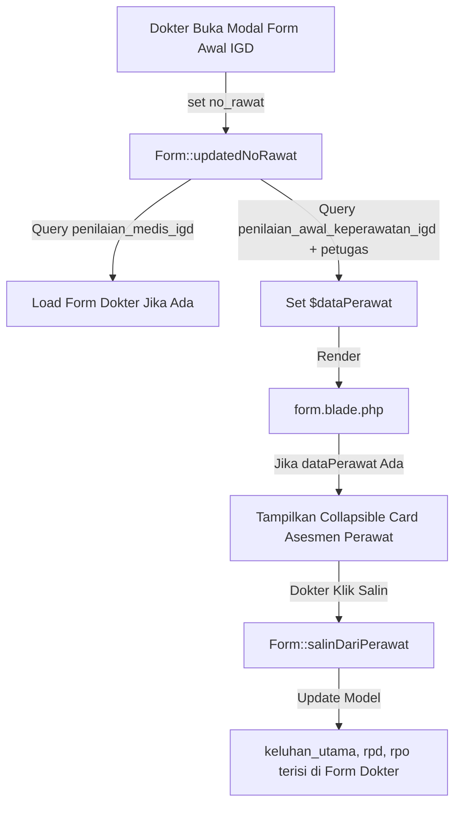

# Desain Spesifikasi: Tampilan Riwayat Asesmen Perawat IGD di Form Asesmen Medis IGD Dokter

## 1. Latar Belakang & Tujuan
Pada saat dokter IGD membuka modal pengisian asesmen medis (`App\Http\Livewire\Component\AwalIgd\Form`), dokter membutuhkan referensi hasil pengkajian awal yang telah dilakukan oleh perawat IGD (`penilaian_awal_keperawatan_igd`) pada kunjungan tersebut (`no_rawat`). Fitur ini menambahkan panel referensi riwayat asesmen perawat yang collapsible di bagian atas form, dilengkapi tombol untuk menyalin data keluhan dan riwayat penyakit langsung ke input dokter.

## 2. Arsitektur & Alur Data



## 3. Komponen & Perubahan File

### 3.1 Backend Component: `app/Http/Livewire/Component/AwalIgd/Form.php`
- Tambah property:
  ```php
  public $dataPerawat = null;
  ```
- Di method `resetInput()`:
  ```php
  $this->dataPerawat = null;
  ```
- Di method `updatedNoRawat()`:
  Tambahkan query:
  ```php
  $this->dataPerawat = DB::table('penilaian_awal_keperawatan_igd')
      ->leftJoin('petugas', 'penilaian_awal_keperawatan_igd.nip', '=', 'petugas.nip')
      ->where('penilaian_awal_keperawatan_igd.no_rawat', $this->no_rawat)
      ->select('penilaian_awal_keperawatan_igd.*', 'petugas.nama as nama_petugas')
      ->first();
  ```
- Tambah action method `salinDariPerawat()`:
  ```php
  public function salinDariPerawat()
  {
      if (!$this->dataPerawat) {
          $this->alert('warning', 'Data asesmen keperawatan tidak ditemukan');
          return;
      }

      if (!empty($this->dataPerawat->keluhan_utama)) {
          $this->keluhan_utama = $this->dataPerawat->keluhan_utama;
      }
      if (!empty($this->dataPerawat->rpd)) {
          $this->rpd = $this->dataPerawat->rpd;
      }
      if (!empty($this->dataPerawat->rpo)) {
          $this->rpo = $this->dataPerawat->rpo;
      }

      $this->alert('success', 'Data keluhan & riwayat berhasil disalin dari perawat');
  }
  ```

### 3.2 Frontend View: `resources/views/livewire/component/awal-igd/form.blade.php`
- Tepat di atas Section I (Riwayat Kesehatan), tambahkan:
  ```blade
  @if(!empty($dataPerawat))
  <div class="card card-outline card-success mb-3">
      <div class="card-header py-2 d-flex justify-content-between align-items-center">
          <h6 class="card-title text-sm mb-0">
              <i class="fas fa-user-nurse text-success mr-1"></i> Asesmen Awal Keperawatan IGD
              <span class="badge badge-light border ml-1">{{ $dataPerawat->nama_petugas ?? $dataPerawat->nip }}</span>
              <small class="text-muted ml-2">({{ date('d/m/Y H:i', strtotime($dataPerawat->tanggal)) }})</small>
          </h6>
          <div class="card-tools">
              <button type="button" class="btn btn-xs btn-outline-success mr-1" wire:click="salinDariPerawat" title="Salin Keluhan, RPD & RPO ke Form Dokter">
                  <i class="fas fa-copy mr-1"></i> Salin ke Form Dokter
              </button>
              <button type="button" class="btn btn-tool" data-card-widget="collapse">
                  <i class="fas fa-minus"></i>
              </button>
          </div>
      </div>
      <div class="card-body py-2 px-3 text-sm">
          <div class="row">
              <div class="col-md-6 mb-2">
                  <small class="text-muted d-block">Keluhan Utama (Perawat):</small>
                  <div class="font-weight-bold">{{ $dataPerawat->keluhan_utama ?: '-' }}</div>
              </div>
              <div class="col-md-3 mb-2">
                  <small class="text-muted d-block">Riwayat Penyakit Dahulu:</small>
                  <div>{{ $dataPerawat->rpd ?: '-' }}</div>
              </div>
              <div class="col-md-3 mb-2">
                  <small class="text-muted d-block">Riwayat Pengobatan:</small>
                  <div>{{ $dataPerawat->rpo ?: '-' }}</div>
              </div>
          </div>
          <div class="row pt-1 border-top">
              <div class="col-md-3">
                  <small class="text-muted d-block">Pengkajian Nyeri:</small>
                  <span>{{ $dataPerawat->nyeri ?: 'Tidak' }} (Skala: {{ $dataPerawat->skala_nyeri ?: '0' }})</span>
              </div>
              <div class="col-md-3">
                  <small class="text-muted d-block">Risiko Jatuh:</small>
                  <span>{{ $dataPerawat->hasil ?: '-' }}</span>
              </div>
              <div class="col-md-3">
                  <small class="text-muted d-block">Status Kehamilan:</small>
                  <span>{{ $dataPerawat->status_kehamilan ?: '-' }}</span>
              </div>
              <div class="col-md-3">
                  <small class="text-muted d-block">Tekanan / Rencana:</small>
                  <span>{{ $dataPerawat->rencana ?: '-' }}</span>
              </div>
          </div>
      </div>
  </div>
  @endif
  ```

## 4. Edge Cases
1. `dataPerawat` null: card tidak render sama sekali, form dokter berfungsi seperti biasa.
2. Form dokter sudah terisi sebagian: `salinDariPerawat` hanya menimpa `keluhan_utama`, `rpd`, `rpo` jika di perawat ada isinya.
3. Reset form saat ganti `no_rawat`: `dataPerawat` ikut direset ke null sebelum dimuat ulang.

## 5. Rencana Verifikasi
1. Sintaks PHP valid: `php -l app/Http/Livewire/Component/AwalIgd/Form.php`.
2. Compile Blade view: `php artisan view:clear`.
3. Unit/Feature test atau Tinker test untuk method `salinDariPerawat` & query `dataPerawat`.
