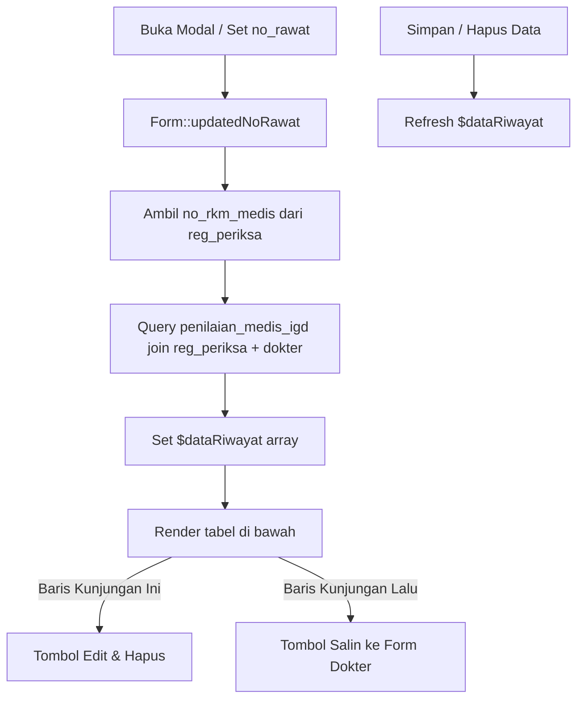

# Desain Spesifikasi: Tabel Riwayat Penilaian Awal Medis IGD di Bawah Modal Form Dokter

## 1. Latar Belakang & Tujuan
Pada modal input Penilaian Awal Medis IGD (`App\Http\Livewire\Component\AwalIgd\Form`), dokter membutuhkan visibilitas riwayat input asesmen medis IGD pasien (`penilaian_medis_igd`) yang telah tersimpan. Fitur ini menambahkan tabel riwayat input di bagian bawah form (di bawah tombol Simpan & Hapus) yang menampilkan riwayat asesmen medis IGD pasien berdasarkan nomor rekam medis (`no_rkm_medis`), mencakup kunjungan saat ini maupun kunjungan-kunjungan sebelumnya.

## 2. Arsitektur & Alur Data



## 3. Komponen & Perubahan File

### 3.1 Backend Component: `app/Http/Livewire/Component/AwalIgd/Form.php`
- Tambah property:
  ```php
  public $dataRiwayat = [];
  ```
- Method `loadRiwayat()`:
  ```php
  public function loadRiwayat()
  {
      if (!$this->no_rawat) {
          $this->dataRiwayat = [];
          return;
      }

      $noRm = DB::table('reg_periksa')->where('no_rawat', $this->no_rawat)->value('no_rkm_medis');
      if (!$noRm) {
          $this->dataRiwayat = [];
          return;
      }

      $this->dataRiwayat = DB::table('penilaian_medis_igd')
          ->join('reg_periksa', 'penilaian_medis_igd.no_rawat', '=', 'reg_periksa.no_rawat')
          ->leftJoin('dokter', 'penilaian_medis_igd.kd_dokter', '=', 'dokter.kd_dokter')
          ->where('reg_periksa.no_rkm_medis', $noRm)
          ->select('penilaian_medis_igd.*', 'dokter.nm_dokter', 'reg_periksa.tgl_registrasi')
          ->orderByDesc('penilaian_medis_igd.tanggal')
          ->get()
          ->map(fn($item) => (array) $item)
          ->toArray();
  }
  ```
- Panggil `$this->loadRiwayat()` pada:
  - `updatedNoRawat()`
  - Akhir method `simpan()` setelah upsert
  - Akhir method `hapus()` setelah delete
- Method `editRiwayat($noRawat)`:
  - Memuat data `penilaian_medis_igd` untuk `$noRawat` tersebut ke dalam model form aktif.
- Method `salinDariRiwayat($noRawat)`:
  - Menyalin field klinis (keluhan, RPS, RPK, RPD, RPO, alergi, TTV, pemeriksaan fisik, organ, diagnosis, tatalaksana) dari record riwayat ke form dokter saat ini.

### 3.2 Frontend View: `resources/views/livewire/component/awal-igd/form.blade.php`
- Letak: Tepat di bawah `</form>` sebelum modal picker.
- Struktur Card Tabel:
  ```blade
  <div class="card card-outline card-info mt-4 shadow-sm">
      <div class="card-header py-2 d-flex justify-content-between align-items-center">
          <h6 class="card-title text-sm mb-0">
              <i class="fas fa-history text-info mr-1"></i> <strong>Riwayat Penilaian Awal Medis IGD Pasien</strong>
          </h6>
          <span class="badge badge-info">{{ count($dataRiwayat) }} Catatan</span>
      </div>
      <div class="card-body p-0 table-responsive">
          <table class="table table-hover table-striped mb-0 text-sm">
              <thead class="thead-light">
                  <tr>
                      <th style="width: 40px;">#</th>
                      <th style="width: 170px;">Waktu & No. Rawat</th>
                      <th style="width: 180px;">Dokter Pemeriksa</th>
                      <th>Keluhan & TTV</th>
                      <th>Diagnosis & Tatalaksana</th>
                      <th class="text-center" style="width: 120px;">Aksi</th>
                  </tr>
              </thead>
              <tbody>
                  @forelse($dataRiwayat as $index => $row)
                  @php
                      $isCurrentVisit = ($row['no_rawat'] === $no_rawat);
                  @endphp
                  <tr class="{{ $isCurrentVisit ? 'table-info' : '' }}">
                      <td>{{ $index + 1 }}</td>
                      <td>
                          <strong>{{ !empty($row['tanggal']) ? date('d/m/Y H:i', strtotime($row['tanggal'])) : '-' }}</strong>
                          <small class="text-muted d-block">{{ $row['no_rawat'] }}</small>
                          @if($isCurrentVisit)
                              <span class="badge badge-success">Kunjungan Ini</span>
                          @else
                              <span class="badge badge-secondary">Kunjungan Lalu</span>
                          @endif
                      </td>
                      <td>
                          <strong>{{ $row['nm_dokter'] ?? $row['kd_dokter'] ?? '-' }}</strong>
                          <div class="text-xs text-muted">{{ $row['anamnesis'] ?? '-' }}</div>
                      </td>
                      <td>
                          <div class="font-weight-bold mb-1">{{ $row['keluhan_utama'] ?: '-' }}</div>
                          <div class="text-xs text-muted">
                              TD: {{ $row['td'] ?: '-' }} | N: {{ $row['nadi'] ?: '-' }} | S: {{ $row['suhu'] ?: '-' }} | RR: {{ $row['rr'] ?: '-' }} | SpO2: {{ $row['spo'] ?: '-' }}
                          </div>
                      </td>
                      <td>
                          <div><strong>Diagnosis:</strong> {{ $row['diagnosis'] ?: '-' }}</div>
                          <div class="text-xs text-muted"><strong>Tatalaksana:</strong> {{ \Illuminate\Support\Str::limit($row['tata'] ?: '-', 80) }}</div>
                      </td>
                      <td class="text-center align-middle">
                          @if($isCurrentVisit)
                              <button type="button" class="btn btn-xs btn-warning mb-1" wire:click="editRiwayat('{{ $row['no_rawat'] }}')" title="Muat ke Form">
                                  <i class="fas fa-edit mr-1"></i> Edit
                              </button>
                          @else
                              <button type="button" class="btn btn-xs btn-outline-primary" wire:click="salinDariRiwayat('{{ $row['no_rawat'] }}')" title="Salin Data Riwayat ke Form">
                                  <i class="fas fa-copy mr-1"></i> Salin
                              </button>
                          @endif
                      </td>
                  </tr>
                  @empty
                  <tr>
                      <td colspan="6" class="text-center text-muted py-3">
                          <i class="fas fa-info-circle mr-1"></i> Belum ada riwayat penilaian medis IGD untuk pasien ini.
                      </td>
                  </tr>
                  @endforelse
              </tbody>
          </table>
      </div>
  </div>
  ```

## 4. Edge Cases
1. `no_rawat` kosong: `$dataRiwayat` kosong array `[]`.
2. Pasien baru pertama kali masuk IGD dan belum ada input: tabel menampilkan baris empty.
3. Setelah klik Simpan: tabel otomatis reload menampilkan baris input terbaru yang ditandai badge `Kunjungan Ini`.
4. Setelah klik Hapus: tabel reload dan baris kunjungan ini hilang.
5. Array format: `$dataRiwayat` murni array PHP untuk mencegah serialization crash di Livewire 2.

## 5. Rencana Verifikasi
1. Lint PHP: `php -l app/Http/Livewire/Component/AwalIgd/Form.php`.
2. Unit / Component Test di `tests/Unit/AwalIgdFormTest.php`.
3. Clear view cache & compile blade check.
4. Tinker test dengan record `2026/10/11/000027`.
