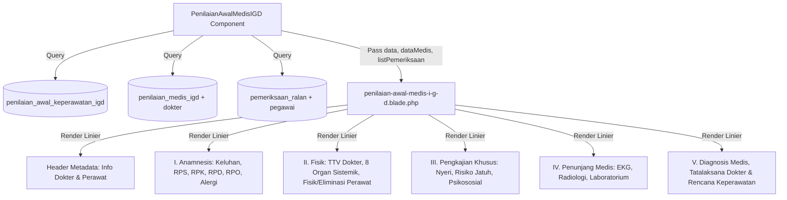

# Desain Spesifikasi: Integrasi Tampilan Riwayat Input Asesmen Medis Dokter IGD

## 1. Latar Belakang & Tujuan
Komponen tampilan `resources/views/components/ralan/penilaian-awal-medis-i-g-d.blade.php` saat ini hanya menampilkan data keperawatan dari tabel `penilaian_awal_keperawatan_igd`. Fitur ini menambahkan pengambilan data input asesmen dokter dari tabel `penilaian_medis_igd` dan menampilkannya secara terpadu (linier) dalam komponen, mencakup riwayat penyakit (RPS/RPK/RPD/RPO), pemeriksaan fisik sistemik dokter, penunjang (EKG/Rad/Lab), diagnosis kerja, dan tatalaksana medis.

## 2. Arsitektur & Alur Data



## 3. Komponen & Perubahan File

### 3.1 Backend Component: `app/View/Components/Ralan/PenilaianAwalMedisIGD.php`
- Tambah method `getPenilaianMedisIGD($noRawat)`:
  ```php
  public function getPenilaianMedisIGD($noRawat)
  {
      if (!$noRawat) return null;

      return DB::table('penilaian_medis_igd')
          ->leftJoin('dokter', 'penilaian_medis_igd.kd_dokter', '=', 'dokter.kd_dokter')
          ->where('penilaian_medis_igd.no_rawat', $noRawat)
          ->select('penilaian_medis_igd.*', 'dokter.nm_dokter')
          ->first();
  }
  ```
- Update `render()`:
  ```php
  public function render()
  {
      return view('components.ralan.penilaian-awal-medis-i-g-d', [
          'data' => $this->getPenilaianIGD($this->noRawat),
          'dataMedis' => $this->getPenilaianMedisIGD($this->noRawat),
          'listPemeriksaan' => $this->getPemeriksaanRalan($this->noRawat),
      ]);
  }
  ```

### 3.2 Parent Component: `app/Http/Livewire/Ralan/PasienTabs.php` & `resources/views/livewire/ralan/pasien-tabs.blade.php`
- Tambah method helper di `PasienTabs.php`:
  ```php
  public function getPenilaianMedisIGD($noRawat)
  {
      return DB::table('penilaian_medis_igd')
          ->where('no_rawat', $noRawat)
          ->exists();
  }
  ```
- Perbarui guard render pada `pasien-tabs.blade.php`:
  ```blade
  @php
  $penilaianIGDVisit = $this->getPenilaianAwalKeperawatanIGD($no_rawat);
  $penilaianMedisVisit = $this->getPenilaianMedisIGD($no_rawat);
  @endphp
  @if($penilaianIGDVisit || $penilaianMedisVisit)
      <x-ralan.penilaian-awal-medis-i-g-d :no-rawat="$no_rawat" />
  @endif
  ```

### 3.3 Blade Template: `resources/views/components/ralan/penilaian-awal-medis-i-g-d.blade.php`
- Guard utama: `@if(!empty($data) || !empty($dataMedis))`
- **Header Info Terpadu**:
  - Tanggal & Dokter Pemeriksa (`dataMedis->nm_dokter`).
  - Tanggal & Perawat Pemeriksa (`data->nama_petugas`).
  - Tombol Klip SOAP Ralan tetap aktif untuk referensi TTV pembanding.
- **I. Anamnesis & Riwayat Kesehatan**:
  - Anamnesis Dokter: `keluhan_utama`, `anamnesis` (Auto/Alloanamnesis), `hubungan`.
  - Riwayat Penyakit: `rps`, `rpk`, `rpd`, `rpo`, `alergi`.
  - Anamnesis Perawat (keluhan/RPD/RPO jika ada perbedaan catatan).
- **II. Pemeriksaan Fisik & TTV Terpadu**:
  - TTV & Keadaan Umum Dokter: `keadaan`, `kesadaran`, `gcs`, `td`, `nadi`, `rr`, `suhu`, `spo`, `tb`, `bb`.
  - Pemeriksaan 8 Organ Sistemik Dokter: Kepala, Mata, Thoraks, Abdomen, Gigi, Genital, Leher, Ekstremitas.
  - Keterangan Fisik / Status Lokalis: `ket_fisik`, `ket_lokalis`.
  - Fisik & Eliminasi Perawat: Pupil, Neurosensorik, Integumen, Turgor, Edema, Perdarahan, BAB, BAK.
- **III. Pengkajian Khusus Keperawatan**:
  - Nyeri, Risiko Jatuh, Psikososial & Budaya.
- **IV. Penunjang Medis (Dokter)**:
  - Ditampilkan bila ada data: EKG (`ekg`), Radiologi (`rad`), Laboratorium (`lab`).
- **V. Asesmen, Diagnosis & Rencana Terpadu**:
  - Diagnosis Medis Dokter (`diagnosis`).
  - Tatalaksana / Terapi Medis Dokter (`tata`).
  - Rencana Asuhan Keperawatan (`rencana`).

## 4. Edge Cases
1. Hanya ada data dokter (`dataMedis` ada, `data` perawat null): tetap render rapi tanpa crash.
2. Hanya ada data perawat (`data` ada, `dataMedis` null): tetap render sesuai format sebelumnya.
3. Kedua data ada: terintegrasi linier harmonis tanpa duplikasi berlebih.

## 5. Rencana Verifikasi
1. Pengecekan sintaks PHP (`php -l`).
2. PHPUnit test untuk method `getPenilaianMedisIGD`.
3. Clear view cache dan render test via Tinker.
