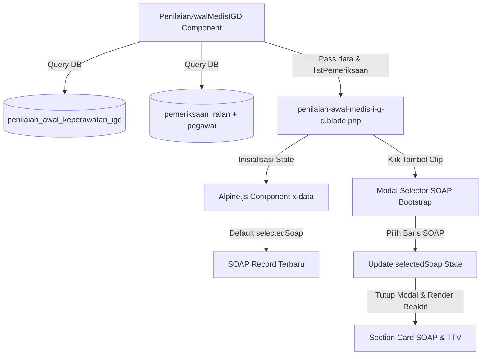

# Desain Spesifikasi: Integrasi Data SOAP Pemeriksaan Ralan ke Penilaian Awal Medis IGD

## 1. Latar Belakang & Tujuan
Komponen tampilan `penilaian-awal-medis-i-g-d.blade.php` saat ini hanya menampilkan data dari tabel `penilaian_awal_keperawatan_igd` tanpa data Tanda-Tanda Vital (TTV) dan catatan SOAP lengkap. Fitur ini menambahkan fungsi pengambilan data SOAP dari tabel `pemeriksaan_ralan` dan antarmuka pemilih (modal selector dengan tombol clip) agar pengguna dapat melihat data SOAP riwayat pemeriksaan pasien.

## 2. Arsitektur & Alur Data



## 3. Komponen & Perubahan File

### 3.1 Backend: `app/View/Components/Ralan/PenilaianAwalMedisIGD.php`
- **Method baru**: `getPemeriksaanRalan($noRawat)`
  - Query:
    ```php
    public function getPemeriksaanRalan($noRawat)
    {
        if (!$noRawat) {
            return collect();
        }

        return DB::table('pemeriksaan_ralan')
            ->leftJoin('pegawai', 'pemeriksaan_ralan.nip', '=', 'pegawai.nik')
            ->where('pemeriksaan_ralan.no_rawat', $noRawat)
            ->select('pemeriksaan_ralan.*', 'pegawai.nama as nama_petugas')
            ->orderBy('pemeriksaan_ralan.tgl_perawatan', 'desc')
            ->orderBy('pemeriksaan_ralan.jam_rawat', 'desc')
            ->get();
    }
    ```
- **Method `render()`**:
  - Mengirim variabel `listPemeriksaan` ke view:
    ```php
    public function render()
    {
        return view('components.ralan.penilaian-awal-medis-i-g-d', [
            'data' => $this->getPenilaianIGD($this->noRawat),
            'listPemeriksaan' => $this->getPemeriksaanRalan($this->noRawat),
        ]);
    }
    ```

### 3.2 Frontend: `resources/views/components/ralan/penilaian-awal-medis-i-g-d.blade.php`

- **Alpine.js State**:
  - `listSoap`: Array JSON hasil koleksi `$listPemeriksaan`.
  - `selectedSoap`: Objek SOAP default (elemen pertama / terbaru, atau `null` jika kosong).
  - Method `selectSoap(soap)`: Mengatur `this.selectedSoap = soap` dan memanggil jQuery `$('#modalPilihSoap-' + modalId).modal('hide')`.

- **Tombol Clip di Header Card**:
  - Ikon: `<i class="fas fa-paperclip"></i>`.
  - Teks: "Data SOAP Ralan".
  - Badge penanda jumlah riwayat: `<span class="badge badge-light ml-1">{{ count($listPemeriksaan) }}</span>`.
  - Trigger: `data-toggle="modal" data-target="#modalPilihSoap-{{ md5($data->no_rawat ?? $noRawat) }}"`.

- **Modal Selector SOAP**:
  - ID Modal: `modalPilihSoap-{{ md5($data->no_rawat ?? $noRawat) }}`.
  - Tabel Daftar SOAP:
    - Kolom: Waktu (Tgl & Jam), Petugas, Tensi, Nadi, Suhu, RR, Keluhan, Aksi.
    - Tombol "Pilih": Memanggil `@click="selectSoap(soap)"` dengan styling outline-primary.

- **Section Tampilan Data SOAP Terpilih**:
  - Directive: `x-show="selectedSoap"` (dengan fallback jika `!selectedSoap` berupa pemberitahuan data belum dipilih/tersedia).
  - Tanda-Tanda Vital (TTV Grid Badge & Info):
    - Tensi (`selectedSoap.tensi`), Nadi (`selectedSoap.nadi`), Suhu (`selectedSoap.suhu_tubuh`), Respirasi (`selectedSoap.respirasi`), SpO2 (`selectedSoap.spo2`).
    - GCS (`selectedSoap.gcs`), Kesadaran (`selectedSoap.kesadaran`), Berat (`selectedSoap.berat`), Tinggi (`selectedSoap.tinggi`), Lingkar Perut (`selectedSoap.lingkar_perut`).
  - Catatan Medis SOAP:
    - S (Subjektif / Keluhan): `selectedSoap.keluhan`
    - O (Objektif / Pemeriksaan Fisik): `selectedSoap.pemeriksaan`
    - A (Asesmen / Penilaian): `selectedSoap.penilaian`
    - P (Plan / RTL / Instruksi / Evaluasi): `selectedSoap.rtl`, `selectedSoap.instruksi`, `selectedSoap.evaluasi`
    - Alergi: `selectedSoap.alergi`

## 4. Penanganan Edge Cases & Keamanan
1. **Pasien tanpa riwayat SOAP (`listPemeriksaan` kosong)**:
   - Tombol clip dinonaktifkan (`disabled`) atau menampilkan badge 0.
   - Section SOAP menampilkan pesan ringkas "Tidak ada data SOAP pemeriksaan ralan".
2. **Karakter Khusus pada JSON**:
   - Gunakan Blade directive `@js($listPemeriksaan)` untuk memastikan escaping aman dan format valid.
3. **Konflik ID Modal pada Halaman Multi-kunjungan**:
   - Gunakan hashing `md5($data->no_rawat)` agar ID modal unik dan tidak tumpang tindih.

## 5. Rencana Verifikasi
1. Pengecekan sintaks PHP di `PenilaianAwalMedisIGD.php` menggunakan `php -l`.
2. Verifikasi render Blade template tidak menghasilkan syntax error.
3. Uji tampilan modal dan pergantian data SOAP melalui browser/UI.
